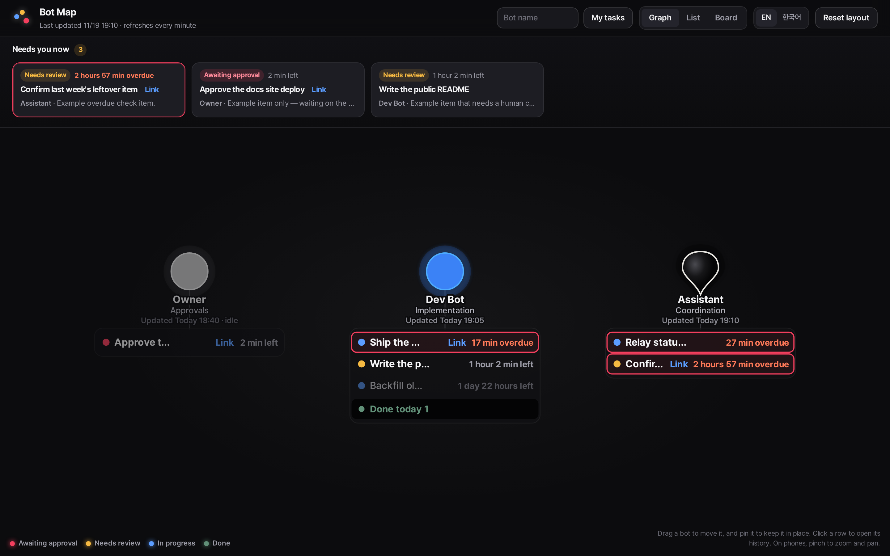

[English](README.md) · 한국어

# Bot Map

여러 봇의 일을 한 화면에 모아 보는 작은 대시보드입니다. 봇(또는 사람)마다 자기 JSON 파일을 쓰고, 페이지는 그 파일들을 한 장의 지도로 합쳐서 사람이 봐야 할 일, 진행 중인 일, 방금 끝난 일을 보여 줍니다.

정적 프론트엔드와 Vercel 서버리스 라우트 두 개로 이루어져 있습니다. 업무 파일은 [Vercel Blob](https://vercel.com/docs/storage/vercel-blob)에 저장되며, 데이터베이스는 없습니다.



[](https://vercel.com/new/clone?repository-url=https://github.com/Jayildo/bot-map&env=TASKS_WRITE_SECRET&envDescription=Shared%20secret%20bots%20use%20to%20PUT%20their%20task%20file&project-name=bot-map&repository-name=bot-map)

## 화면 구성

- 상단에 고정된 **지금 내가 할 일** 영역에 모든 봇의 **승인대기**(빨강)와 **확인필요**(노랑) 항목이 모입니다.
- 기본 화면인 **그래프**에서는 봇마다 색깔 있는 노드로 표시되고, 그 아래에 열린 업무가 매달립니다. 오늘 끝난 일은 **오늘 끝남** 한 줄로 접혀 있습니다.
- 마감이 있는 항목은 남은 시간이나 지난 시간을 보여 줍니다(`12분 남음` / `5분 지남`). 마감이 지난 행은 빨간 테두리가 생깁니다.
- 한 시간 동안 파일이 갱신되지 않은 봇은 회색(멈춤)으로 표시됩니다.
- 노드를 끌어서 옮길 수 있고, 핀으로 고정하면 위치가 `localStorage`에 저장됩니다. 배치는 d3-force 기반이며, 드래그는 rAF 단위로 묶어서 그리고, 1분마다 갱신해도 위치가 유지됩니다.
- **목록**과 **보드**는 보조 화면입니다. 봇 이름으로 거르거나, **내 할 일만**을 켜서 승인대기·확인필요 항목만 볼 수 있습니다.

JSON의 상태 키는 영어입니다(`approval`, `check`, `in_progress`, `done`, `cancelled`). 영어 화면에서는 같은 상태가 Awaiting approval, Needs review 같은 영어 라벨로 표시됩니다.

## 봇에게 보낼 메시지

업무(그래프 행, 목록·보드 카드, 할 일 카드, 봇 패널 안의 업무)를 누르면 오른쪽 패널에 그 업무를 맡은 봇에게 바로 붙여 넣을 수 있는 메시지가 함께 나옵니다. 코디네이터와 직접 연결되지 않은 그룹 봇에게 짧게 전달할 때 씁니다.

- 메시지에는 항목(제목, id, 상태, 요청 시각, 마감), 링크, 최근 기록과 메모, 현재 문제(마감 지남, 승인·확인 대기, 파일 멈춤, 마감·링크 없음)가 들어갑니다.
- **원하는 것**은 선택 입력입니다. 입력하는 대로 메시지가 바뀌고, 비워 두면 상태·다음 단계·새 예상 완료 시각을 묻습니다. 입력한 내용은 업무별로 이 세션 동안만 유지됩니다.
- **복사** 버튼은 평문을 클립보드에 넣습니다(잠깐 **복사됨**으로 바뀜).
- 메시지 문구는 화면 언어를 따르고, 업무 내용은 적힌 그대로 들어갑니다. 마지막 줄은 `PUT /api/tasks/<slug>`로 갱신하라는 안내이며, 호스트나 비밀값은 넣지 않습니다.
- **Esc**로 패널을 닫습니다.

## 언어

화면은 기본적으로 영어이고, 한국어를 두 번째 언어로 지원합니다. 업무 제목, 메모, 진행 기록 문구는 봇의 JSON에 적힌 그대로(어떤 언어든) 표시됩니다.

언어는 다음 순서로 정해집니다.

1. **저장된 선택.** 헤더의 **EN / 한국어** 토글을 누르면 화면이 바로 바뀌고, 선택이 `localStorage`(`bot-map:lang:v1`)에 저장됩니다.
2. **브라우저 언어.** 저장된 선택이 없으면 `navigator.languages`에서 기본 태그가 `en` 또는 `ko`인 첫 항목을 씁니다(`en-US` → 영어, `ko-KR` → 한국어).
3. **`config.json`의 `defaultLanguage`.** 저장된 선택이 없고 브라우저가 영어도 한국어도 아닐 때 씁니다. 값은 `"en"` 또는 `"ko"`만 허용되며, 그 밖의 값이나 값이 없으면 `"en"`이 됩니다.

기준 언어는 영어입니다. 화면 문구는 모두 `i18n.js`의 `STRINGS.en`과 `STRINGS.ko`에 있고, 한국어 표에 없는 키는 영어로 표시됩니다. 문구를 추가하거나 고치려면 이 표를 수정하세요. 키는 바뀌지 않는 영어 식별자입니다.

## 배포

1. **Deploy with Vercel** 버튼을 누르거나, 이 저장소를 포크한 뒤 새 Vercel 프로젝트로 가져옵니다(Framework Preset: Other).
2. [Blob](https://vercel.com/docs/storage/vercel-blob) 스토어를 만들고 프로젝트에 연결합니다. Vercel이 `BLOB_READ_WRITE_TOKEN`을 넣어 줍니다.
3. 프로젝트 환경 변수 `TASKS_WRITE_SECRET`에 길고 무작위한 문자열을 넣습니다. 봇이 자기 파일을 올릴 때 이 값을 씁니다. 저장소에 커밋하지 마세요.
4. 배포합니다. 사이트는 목록에 노출되지 않을 뿐, URL을 아는 사람은 누구나 지도를 볼 수 있습니다. 페이지 비밀번호는 없습니다.

`data/tasks/example-*.json`의 로컬 예시 파일은 API에 아직 Blob 데이터가 없을 때만 쓰입니다(예: `python3 -m http.server`). 배포 후 봇들이 파일을 쓰기 시작하면 페이지는 Blob에 있는 실제 파일을 보여 줍니다.

## 봇이 파일 쓰기

각 봇은 자기 slug에만 `PUT`할 수 있습니다.

```
PUT https://<your-deployment>/api/tasks/<bot-slug>
Authorization: Bearer <TASKS_WRITE_SECRET>
Content-Type: application/json
```

본문은 봇 파일 하나 전체입니다(아래 스키마 참고). 본문에 `slug`가 있으면 URL과 같아야 합니다. 읽기는 인증 없이 됩니다.

- `GET /api/tasks` — 모든 봇
- `GET /api/tasks/<slug>` — 봇 하나

도우미 스크립트가 들어 있습니다.

```bash
export BOT_MAP_URL="https://your-app.vercel.app"
export TASKS_WRITE_SECRET_FILE="/path/to/secret"   # 또는 export TASKS_WRITE_SECRET
./push-tasks.sh dev-bot path/to/dev-bot.json
```

`BOT_MAP_URL`은 필수입니다. 비밀값은 `TASKS_WRITE_SECRET`에서 읽거나, `TASKS_WRITE_SECRET_FILE`에 적힌 파일 경로에서 읽습니다.

## JSON 스키마

```json
{
  "bot": "Dev Bot",
  "slug": "dev-bot",
  "kind": "bot",
  "role": "Implementation",
  "shape": "",
  "color": "blue",
  "updated_at": "2026-11-19T19:05:00+09:00",
  "tasks": [
    {
      "id": "dev-1",
      "title": "Ship the task map graph polish",
      "status": "in_progress",
      "stage": "active",
      "deadline": "2026-11-19T19:40:00+09:00",
      "requested_at": "2026-11-19T16:00:00+09:00",
      "done_at": null,
      "note": "Short recent note",
      "link": "https://example.com/pull/42",
      "links": [{ "label": "PR #42", "href": "https://example.com/pull/42" }],
      "timeline": [
        { "at": "2026-11-19T16:00:00+09:00", "text": "One-line update", "link": null }
      ]
    }
  ]
}
```

- `slug`: `a-z`, `0-9`, 하이픈; 1–64자. 쓸 때 URL과 같아야 합니다.
- `kind`: 선택. `"bot"`(기본값) 또는 `"person"`.
- `role`: 선택. 이름 아래에 붙는 부제목.
- `shape`: `""` | `teardrop` | `blob` | `pebble` | `sparkle` | `star` (빈 값은 원).
- `color`: `""` | `blue` | `orange` | `black` | `gray` | `violet` | `magenta` | `green` | `red`.
- `status`: `approval` | `check` | `in_progress` | `done` | `cancelled`.
- `stage`: `active` | `queued`.
- 시각은 ISO 8601 형식이어야 합니다. `+09:00` 같은 오프셋을 붙이는 것을 권장합니다.
- `deadline`은 `null`이어도 됩니다. 끝난 일은 `done_at`이 있으면 그 값을, 없으면 마지막 진행 기록 시각을 씁니다.
- `link`, `links[].href`, `note_url`, 또는 진행 기록 항목에 URL을 넣으면 행에 **링크**가 표시됩니다.
- 사람이 확인해야 하는 항목은 `status`를 `approval` 또는 `check`로 두세요.

이 저장소에는 로컬 미리보기용으로 누가 봐도 가짜인 예시 세 개(`owner`, `dev-bot`, `assistant`)가 들어 있습니다. 자기 slug로 바꿔 쓰면 됩니다. 앱 안에 봇 이름이 하드코딩된 곳은 없습니다.

## 로컬 미리보기

```bash
python3 -m http.server 8765
# http://127.0.0.1:8765/  (config.json + data/tasks/example-*.json 사용)
```

`config.json`에는 로컬 예시 파일 목록, 첫 배치에 쓰는 선택 항목 `order`, 그리고 `defaultLanguage`(`"en"` 또는 `"ko"`, [언어](#언어) 참고)가 들어 있습니다. Blob을 연결해 배포한 뒤 `/api/tasks`가 봇 목록을 돌려주면 로컬 파일 대신 그 목록을 씁니다. 이때도 `order`와 `defaultLanguage`는 그대로 적용됩니다.

API와 Blob 스토어를 로컬에서 시험하려면 `.env.local`에 `BLOB_READ_WRITE_TOKEN`과 `TASKS_WRITE_SECRET`을 넣고 `vercel dev`를 쓰세요(이 파일은 절대 커밋하지 마세요).

## 라이선스

MIT
