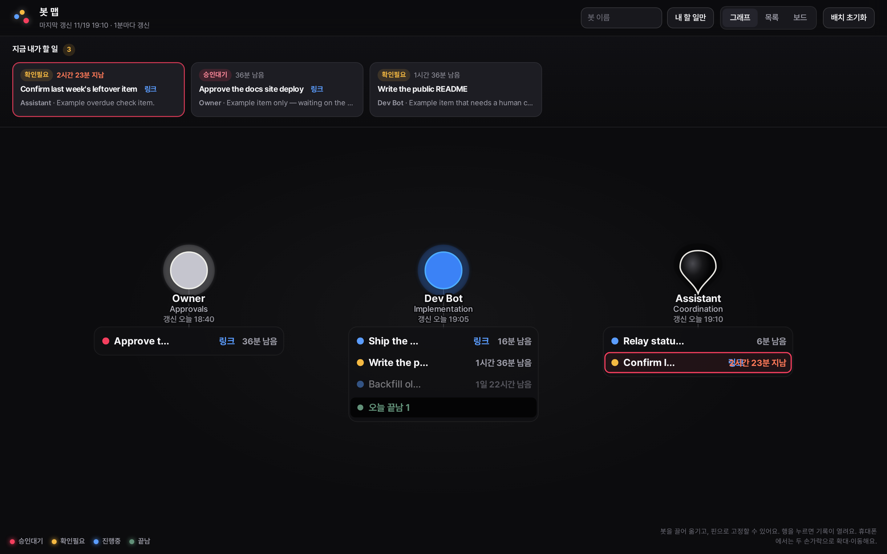

# Bot Map

A small multi-bot task dashboard. Each bot (or person) writes its own JSON file; the page combines them into one map so you can see what needs a human, what is in progress, and what just finished.

The page is a static frontend plus two Vercel serverless routes. Task files live in [Vercel Blob](https://vercel.com/docs/storage/vercel-blob). There is no database.



[](https://vercel.com/new/clone?repository-url=https://github.com/Jayildo/bot-map&env=TASKS_WRITE_SECRET&envDescription=Shared%20secret%20bots%20use%20to%20PUT%20their%20task%20file&project-name=bot-map&repository-name=bot-map)

## What you see

- A pinned inbox, **지금 내가 할 일**, collects every bot's **승인대기** (approval needed, red) and **확인필요** (needs check, yellow) items.
- The main **그래프** (graph) view shows each bot as a colored node with its open tasks hanging underneath. Done work for today is collapsed into a **오늘 끝남** row.
- Items with a deadline show remaining or overdue time (`12분 남음` / `5분 지남`). Overdue rows get a red outline.
- A bot whose file has not been updated in an hour is drawn grey (stale).
- Drag a node to move it. Pin it to keep the position in `localStorage`. Layout is force-based (d3-force); dragging is rAF-batched and positions survive the 60-second refresh.
- **목록** (list) and **보드** (board) are secondary views. Filter by bot name, or turn on **내 할 일만** to show only approval / check items.

The UI copy is Korean. Status keys in the JSON are English (`approval`, `check`, `in_progress`, `done`, `cancelled`).

## Deploy

1. Click **Deploy with Vercel**, or fork this repo and import it as a new Vercel project (Framework Preset: Other).
2. Create a [Blob](https://vercel.com/docs/storage/vercel-blob) store and connect it to the project. Vercel will inject `BLOB_READ_WRITE_TOKEN`.
3. Set a project environment variable `TASKS_WRITE_SECRET` to a long random string. Bots use this to publish their files. Do not commit it.
4. Deploy. The site is unlisted: anyone who knows the URL can read the map. There is no page password.

Local example files under `data/tasks/example-*.json` are used only when the API has no Blob data yet (for example `python3 -m http.server`). After you deploy and bots start writing, the live files in Blob are what the page shows.

## Bots writing their file

Each bot may `PUT` only its own slug:

```
PUT https://<your-deployment>/api/tasks/<bot-slug>
Authorization: Bearer <TASKS_WRITE_SECRET>
Content-Type: application/json
```

The body is one complete bot file (see the schema below). If the body includes `slug`, it must match the URL. Reads are unauthenticated:

- `GET /api/tasks` — all bots
- `GET /api/tasks/<slug>` — one bot

A helper script is included:

```bash
export BOT_MAP_URL="https://your-app.vercel.app"
export TASKS_WRITE_SECRET_FILE="/path/to/secret"   # or export TASKS_WRITE_SECRET
./push-tasks.sh dev-bot path/to/dev-bot.json
```

`BOT_MAP_URL` is required. The secret is read from `TASKS_WRITE_SECRET`, or from the file path in `TASKS_WRITE_SECRET_FILE`.

## JSON schema

```json
{
  "bot": "Dev Bot",
  "slug": "dev-bot",
  "kind": "bot",
  "role": "Implementation",
  "shape": "",
  "color": "blue",
  "updated_at": "2026-11-19T19:05:00+09:00",
  "tasks": [
    {
      "id": "dev-1",
      "title": "Ship the task map graph polish",
      "status": "in_progress",
      "stage": "active",
      "deadline": "2026-11-19T19:40:00+09:00",
      "requested_at": "2026-11-19T16:00:00+09:00",
      "done_at": null,
      "note": "Short recent note",
      "link": "https://example.com/pull/42",
      "links": [{ "label": "PR #42", "href": "https://example.com/pull/42" }],
      "timeline": [
        { "at": "2026-11-19T16:00:00+09:00", "text": "One-line update", "link": null }
      ]
    }
  ]
}
```

- `slug`: `a-z`, `0-9`, hyphen; 1–64 characters. Must match the URL on write.
- `kind`: optional. `"bot"` (default) or `"person"`.
- `role`: optional subtitle under the name.
- `shape`: `""` | `teardrop` | `blob` | `pebble` | `sparkle` | `star` (empty is a circle).
- `color`: `""` | `blue` | `orange` | `black` | `gray` | `violet` | `magenta` | `green` | `red`.
- `status`: `approval` | `check` | `in_progress` | `done` | `cancelled`.
- `stage`: `active` | `queued`.
- Times should be ISO 8601. An offset such as `+09:00` is recommended.
- `deadline` may be `null`. For finished work, `done_at` is used when present; otherwise the last timeline timestamp.
- Put a URL on `link`, `links[].href`, `note_url`, or a timeline entry so the row can show **링크**.
- Human review items should use `status` `approval` or `check`.

This repo ships three clearly fake examples (`owner`, `dev-bot`, `assistant`) for local preview. Replace them with your own slugs; nothing in the app hard-codes bot names.

## Local preview

```bash
python3 -m http.server 8765
# http://127.0.0.1:8765/  (uses config.json + data/tasks/example-*.json)
```

`config.json` lists the local example files and an optional `order` for the first layout. When `/api/tasks` returns bots (after a Blob-backed deploy), that list is used instead.

To exercise the API and Blob store locally, use `vercel dev` with `BLOB_READ_WRITE_TOKEN` and `TASKS_WRITE_SECRET` set in `.env.local` (never commit that file).

## License

MIT

---

## 한국어

여러 봇의 일을 한 화면에 모아 보는 대시보드입니다. 승인대기(빨강), 확인필요(노랑), 진행중(파랑), 오늘 끝난 일(접힘)을 그래프·목록·보드로 보여 주고, 마감이 있으면 남은·지난 시간을 표시합니다. 한 시간 동안 파일이 안 바뀌면 해당 봇은 회색으로 표시됩니다.

Vercel에 올린 뒤 Blob 스토어를 연결하고, `TASKS_WRITE_SECRET`만 환경 변수로 넣으면 됩니다. 각 봇은 `PUT /api/tasks/<slug>`로 자기 파일만 갱신합니다. 배포 주소는 `BOT_MAP_URL`, 비밀값은 `TASKS_WRITE_SECRET` 또는 `TASKS_WRITE_SECRET_FILE`로 `push-tasks.sh`에 넘기면 됩니다.
